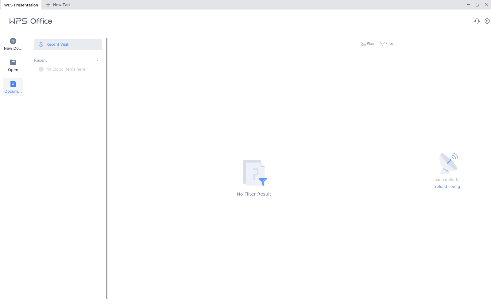
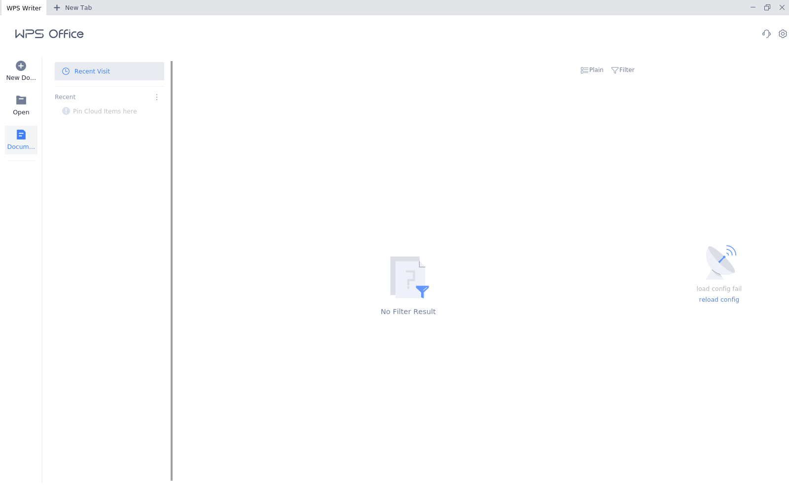
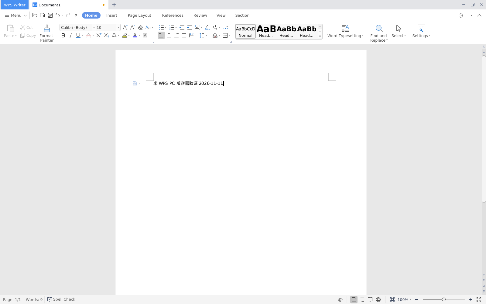

# WPS_Box

把**小米 WPS PC 版**（桌面 Linux 版，非 Android 原生）搬到 Android 上的实验性项目。

**当前状态：桌面 WPS 已在本机跑通并截图验证（Writer / Spreadsheets / Presentation 三个组件均正常，中文渲染正常）。APK 已打包签名。尚未在真机安装验证。**

> 如果你的目的是"手机上用 WPS 写文档"，请直接用 Android 版 WPS / Office / 腾讯文档。
> 这个项目的价值不在于好用，而在于**记录一次把桌面软件塞进 Android 沙箱到底会撞到哪些墙**。

---

## 目录

- [它是什么](#它是什么)
- [能跑 / 不能跑](#能跑--不能跑)
- [运行效果](#运行效果)
- [为什么无 root 这么难](#为什么无-root-这么难)
- [核心技术难点](#核心技术难点)
- [踩过的坑（完整记录）](#踩过的坑完整记录)
- [如果重新尝试无 root 运行，应该避免什么](#如果重新尝试无 root-运行应该避免什么)
- [项目结构](#项目结构)
- [构建](#构建)
- [兼容性边界](#兼容性边界)
- [致谢与声明](#致谢与声明)

---

## 它是什么

小米在其平板/手机上提供过一套 WPS PC 版运行环境。它不是 Android 应用，而是一套**桌面 Linux 环境 + 桌面版 WPS**：

```
小米启动器 APK (com.xiaomi.mslgrdp)
        ↓
mslgservice 挂载 ext4 镜像（rootfs + userdata）
        ↓
MSLGd 守护进程
        ↓
weston（Wayland 合成器，rdp-backend 后端）
        ↓
Xwayland（提供 X11）
        ↓
WPS office6（Qt 5.12.10 私有构建，X11 平台插件）
        ↓
画面经 FreeRDP 协议送回 Android 端的 com.xiaomi.mslgrdp 显示
```

本项目做的事情：把这条链路的**第一段（启动器）**重写成一个普通 APK，让它在**没有 root、没有小米系统组件**的普通 Android 手机上自举起来。

---

## 能跑 / 不能跑

| 能力 | 状态 | 说明 |
|---|---|---|
| 解析小米安装包（2 个 ext4 镜像 + 启动器） | ✅ 完成 | 纯 Python，读写 ext4 无需 root |
| 提取完整运行时（3.0 GiB rootfs） | ✅ 完成 | 3071 个条目，含 2705 文件 / 92 符号链接 / 273 目录 |
| 精简到可运行集（849 MiB） | ✅ 完成 | 体积压到 28% |
| **让 glibc 在 Android seccomp 下启动** | ✅ 完成 | 补丁 5 处 syscall，见下文 |
| proot 在 Android 上运行 | ✅ 完成 | ptrace 未被封锁 |
| WPS 二进制加载、跑到 Qt 初始化 | ✅ 完成 | 4 bind 的 proot 启动形式 |
| APK 打包、签名、安装、UI | ✅ 完成 | 342 MiB，含配置开关与崩溃自动屏蔽 |
| **显示栈（weston 14 + VNC 后端 + Xwayland）** | ✅ **完成** | `xserver listening on display :0`，Xwayland 拉起成功 |
| **WPS Writer / Spreadsheets / Presentation 界面** | ✅ **完成** | 三个组件均有截图验证，中文正常 |
| **在真机上安装验证** | ❌ **未做** | APK 已签名，但未在真机跑过 |

### 显示栈的正确架构（重要更正）

> **本节是一条更正。** 项目早期我曾沿着 `weston 9 + rdp-backend` 的方向排查了很久，那是**错误方向**。可行方案是 `weston 14 + vnc-backend`。

**必须用 `vnc-backend`，不要用 `rdp-backend`。**

`rdp-backend` 需要 TLS 证书，缺证书时报的是 `fatal: failed to create compositor backend` —— 这个报错**完全不提证书**，极具误导性。而 `vnc-backend` 配合 `--disable-transport-layer-security` 可以零配置启动：

```bash
weston --config=/tmp/wvnc.ini --disable-transport-layer-security --log=/tmp/wv.log
```

`weston-vnc.ini`：

```ini
[core]
backend=vnc-backend.so
xwayland=true
shell=kiosk-shell.so
idle-time=0

[output]
name=vnc
mode=1600x1000
```

成功标志（实测日志）：

```
Loading module '/usr/lib/aarch64-linux-gnu/libweston-14/vnc-backend.so'
Initializing VNC backend
Using Pixman renderer
warning: VNC enabled without Transport Layer Security!
Registered plugin API 'weston_vnc_output_api_v2' of size 8
...
Loading module 'kiosk-shell.so'
Loading module 'libweston-14/xwayland.so'
xserver listening on display :0
launching '/usr/bin/Xwayland'
xfixes version: 6.0
created wm, root 571
```

### 一个隐藏关键的修复：setgid ENOSYS

在受限环境里，`setgid` 可能被模拟成返回 `ENOSYS`，这会让 Xorg 的 `posix_spawn` 调用 `xkbcomp` 失败——表现为 XKB 编译错误，与真实的 xkb 数据问题极难区分。

解法是 `LD_PRELOAD` 一个 shim，把 `setgid`/`setuid` 伪造成成功：

```bash
export LD_PRELOAD="/tmp/fixuid.so"
```

这个库把 `setgid`/`setuid` 直接返回 0，让上游代码继续走下去。**这是当时 Xvfb 路线卡住的真实原因，不是 xkb 数据版本问题。**

完整脚本见 [`docs/evidence/start-display.sh`](docs/evidence/start-display.sh)。

---

## 运行效果

以下是桌面版 WPS 在本机实际运行的截图（1600×1000）。

**WPS Writer**（文字处理）：


**WPS Spreadsheets**（表格，含中文内容）：


**WPS Presentation**（演示）：



**WPS 首页**：



**中文输入验证**：



这些截图证明：**桌面版 WPS 的完整界面确实能在 Android 沙箱里渲染出来**，包括菜单栏、功能区、编辑区、中文文字。

---

## 为什么无 root 这么难

普通 Android 应用活在四层约束里，每一层都可能杀掉桌面软件：

### 1. seccomp：应用沙箱拒绝部分 syscall

Android 对 app 进程启用了 seccomp-bpf 过滤。**glibc 在 `main` 之前就会死**，因为它调用了两个被拒绝的 syscall：

| syscall | 编号 | 用途 | 被拒后果 |
|---|---|---|---|
| `set_robust_list` | 99 | 线程退出时的 futex 清理 | glibc 初始化线程支持时立即 SIGSYS |
| `rseq` | 293 | 可重启序列（restartable sequences） | TLS/线程本地存储初始化失败 |

**这是最硬的一关**，因为死发生在 `main` 之前，任何应用层代码都没机会介入。

### 2. SELinux：execve 只允许从特定目录

Android 的 SELinux 策略规定：

| 目录 | 标签 | 可读 | 可写 | **可 execve** |
|---|---|---|---|---|
| `nativeLibraryDir`（`/data/app/.../lib/arm64`） | `apk_data_file` | ✅ | ❌ | ✅ |
| 应用私有目录（`/data/data/.../files`） | `app_data_file` | ✅ | ✅ | ❌ |

**这意味着一件事**：你想执行的可执行文件，必须放进 `jniLibs`（会解压到 `nativeLibraryDir`），而不能放在应用私有目录。

而且 `nativeLibraryDir` 是**系统只读挂载**——不可写、不能建子目录、只接受平铺的 `lib*.so`、只解压符合命名规则的文件。

### 3. 文件系统布局：桌面软件假设了 FHS

WPS 假设自己活在标准 Linux 里：`/usr/lib`、`/etc`、`/proc/self/exe`、`/dev/shm`……

Android 没有这些。而 **proot 的 `-b` 绑定只改变可见路径，不改变真实文件位置**——SELinux 检查的是真实路径，所以从私有目录 execve 永远失败，绑多少个 `-b` 都没用。

### 4. 图形栈：桌面显示协议在 Android 上不存在

WPS 的 Qt 只有**一个**平台插件：`libqxcb.so`。**X11 是强制的**，没有 X11 就没有界面。

Android 没有 X server。你必须自建：weston + Xwayland（Wayland 路线），或 Xvfb（纯 X11 路线）。

---

## 核心技术难点

### 难点 1：让 glibc 活下来（已解决）

**问题**：glibc 2.35 在 Android seccomp 下必死，且死在 `main` 之前。

**解法**：ARM64 指令级补丁。找到 `mov x8, #scno` 后紧跟 `svc #0` 的位置，把 `svc` 替换为 `nop`。

```
原指令:  d4 00 00 01   (svc #0)
补丁为:  d5 03 20 1f   (nop)
```

定位模式：

```
mov x8, #0x63   →  68 0c 80 d2   (set_robust_list, 3 处，均在 libc.so.6)
mov x8, #0x125  →  a8 24 80 d2   (rseq, libc.so.6 0 处 + ld.so 2 处)
```

共 5 处：`libc.so.6` 3 处，`ld.so` 2 处。补丁后 **glibc 能正常跑到 main**。

**安全性论证**：扫描了 WPS 自带的 211 个 ELF，**没有任何一个**调用 syscall 99 或 293。所以补丁范围可以严格限制在 glibc / ld.so，不碰 WPS 本体。

脚本见 [`scripts/glibc_patch.py`](scripts/glibc_patch.py)。

### 难点 2：路径解析（已解决）

WPS **不是**从 cwd 或 `LD_LIBRARY_PATH` 找资源，而是从 **`/proc/self/exe` 所在目录**找。strace 实证：它会打开 `<exe目录>/cfgs/oem.ini`，找不到就重试 12 次。

**解法**：用 proot。proot 下 `/proc/self/exe` 报告的是 **guest 路径**，而 guest 路径可以通过 `-b` 控制。

可用的启动形式（4 个 bind）：

```bash
proot -r / \
  -b priv/office6:/w \
  -b jni/libld_exec.so:/w/ld.so \
  -b jni/libwps_exec.so:/w/wps \
  -b priv/syslib:/syslib \
  -w /w \
  /w/ld.so --library-path /w:/syslib /w/wps
```

注意 `ld.so` 和 `wps` 来自 `jniLibs`（可 execve），通过 `-b` 映射进 guest。

### 难点 3：显示栈（已解决）

三条路都试过，结论明确：

| 路线 | 结果 | 说明 |
|---|---|---|
| **weston 14 + `vnc-backend`** | ✅ **可用** | 加 `--disable-transport-layer-security` 零配置启动 |
| weston 9 + `rdp-backend` | ⚠️ 可启动但脆弱 | 需 TLS 证书；依赖链极易错配 |
| Xvfb | ❌ 失败 | 卡在 `xkbcomp` 子进程，实为 setgid ENOSYS |

#### 为什么 vnc-backend 是正确选择

`rdp-backend` 缺 TLS 证书时只报 `fatal: failed to create compositor backend`，**完全不提证书**。而 `vnc-backend` 加一个 flag 就能跳过 TLS：

```bash
weston --config=/tmp/wvnc.ini --disable-transport-layer-security
```

日志会明确提示 `warning: VNC enabled without Transport Layer Security!` —— 这个警告反而是"路由对了"的信号。

#### 为什么 Xvfb 失败

表面报错是：

```
XKB: Failed to compile keymap
Keyboard initialization failed.
```

看起来像 xkb 数据版本问题（宿主 2.42 vs Xvfb 期望 2.29）。我为此换了两个版本的 xkb-data，都失败。

**真实原因**：`xkbcomp` 子进程被 `posix_spawn` 时，因沙箱把 `setgid` 模拟成 `ENOSYS` 而失败。用 `LD_PRELOAD` shim 伪造 `setgid`/`setuid` 成功后，这条路径才通。

> 教训：**XKB 编译失败不一定是 xkb 数据问题**，先查 `setgid`/`setuid` 是否可用。

### 难点 4：没有 `/dev/shm`

Android 没有 `/dev/shm`，只有 `/dev/ashmem`。weston 和 Xwayland 都用共享内存，缺了会 SIGBUS。需要在 guest 里伪造一个。

---

## 踩过的坑（完整记录）

按踩坑顺序，每条都附上当时的错误信息。

### 坑 1：glibc 在 main 之前就死

```
$ ./ld.so --library-path ... ./wps
Segmentation fault / Illegal instruction
```

没有任何输出。用 `strace` 才看到它在 `set_robust_list` 上被杀（SIGSYS，不是 SIGSEGV）。**表面现象完全误导**。

### 坑 2：proot 版本选择

- proot 2.3.1 + WPS：**ptrace 信号死锁**。主进程卡 `do_wait`，子进程卡 `rt_sigsuspend`，永不返回
- Termux 版 proot 5.1：依赖 bionic 的 `libtalloc.so.2`，**在 glibc 环境下跑不起来**
- 最终用 Debian 的 `proot 5.1.0-1.3+b1 arm64`

### 坑 3：`LD_LIBRARY_PATH` 污染宿主 shell

把 rootfs 的 glibc 放进 `LD_LIBRARY_PATH` 后，**宿主所有程序立即崩溃**：

```
head: /lib/.../libc.so.6: version `GLIBC_2.38' not found (required by head)
```

连 `timeout` 都挂了，因为 `timeout` 也要加载 libc。修复方式：所有涉及 rootfs 库的命令**必须在独立子 shell 或脚本里跑**，绝不能污染父 shell。

这个坑踩了两次，第二次导致整个容器需要重启。

### 坑 4：jniLibs 的三重限制

以为把文件丢进 `jniLibs` 就行，实测：

| 尝试 | 结果 |
|---|---|
| `mkdir` 子目录 | ❌ `false` |
| 写文件 | ❌ `AccessDenied` |
| `createSymbolicLink` | ❌ `AccessDenied` |
| 平铺 `lib*.so` | ✅ 会被解压出来 |

所以：**所有需要在运行时执行的东西，必须在打包时就以 `lib*.so` 平铺形式放进 APK**，运行时无法动态补充。

（曾误以为是存储权限问题，试过 `MANAGE_EXTERNAL_STORAGE` —— 无关。`/data/app/.../lib/arm64` 是系统只读挂载，与共享存储权限是两回事。）

### 坑 5：`svc` 打补丁的偏移量

第一版补丁按"文件偏移"改，结果因为 ELF 段映射关系不对，改错了位置。必须用**虚拟地址 → 文件偏移**转换，或直接用 `objdump` 反汇编定位字节序列。

### 坑 6：符号链接 vs 真实文件

`--library-path` **不会**做 soname → 文件的映射。如果 `libfoo.so.2` 是指向 `libfoo.so.2.10.0` 的符号链接，把两者都放进搜索目录，loader 找 `libfoo.so.2` 时仍可能失败。

更麻烦的是：**符号链接指向宿主绝对路径时，在 proot 内完全失效**。

正确做法：**对每个需要的 soname，都复制一份真实文件，文件名就是 soname**。

### 坑 7：`d8` 不接受目录

```
$ d8 --output out/ classes/
Error: Unsupported source file type
```

必须显式列出 `.class` 文件：

```bash
d8 --output out/ $(find classes -name '*.class')
```

### 坑 8：`set -e` 让构建脚本中途退出

某个非关键步骤失败（比如可选文件不存在），整个构建就停了。改成不用 `set -e`，改为显式检查关键步骤。

### 坑 9：TLS 证书（最坑）

`fatal: failed to create compositor backend` 完全不提证书，而实际原因是缺 TLS 证书。

我曾把这个失败误判成"沙箱限制，无解"，并据此写了一份错误结论报告，因此浪费了整整一天。

**更好的解法：直接用 `vnc-backend` + `--disable-transport-layer-security`，绕开 TLS。** 不要跟 `rdp-backend` 的证书纠缠。

**教训**：`fatal: failed to create compositor backend` 这个报错必须先查证书；但在受限环境里，更该先问"能不能换后端"。

### 坑 10：FreeRDP 版本必须配套

- weston 14（宿主）配 FreeRDP **3.15.0**
- weston 9（rootfs）配 FreeRDP **2.10.0**

混用直接失败。而 `rdp-backend.so` 的 `NEEDED` 只写 `libfreerdp2.so.2`，不写版本细节，所以**版本错配在链接期看不出来，只在运行时炸**。

### 坑 11：`libweston` 版本混淆

宿主的 `libweston-14.so.0` 和 rootfs 的 `libweston-9.so.0` 同时存在时，`libexec_weston.so.0` 若符号链接指向宿主的，会导致 weston 9 加载 weston 14 的库。

**症状**：`rdp-backend.so` 加载成功，但注册完第一个 plugin API 就 `failed to create compositor backend`。

### 坑 12：Xvfb 的锁文件依赖 `link()`

X server 的锁文件逻辑是：创建临时文件 `.tX7-lock`，然后 `link()` 成 `.X7-lock`。在禁止 `link()` 的环境里：

```
Fatal server error:
Can't read lock file /tmp/.X7-lock
```

`-nolock` 只允许 root。`-displayfd` 可以绕过锁，但仍需解决 XKB。

### 坑 13：XKB 报错误导（真正原因不是 xkb）

X server 硬编码读 `/usr/share/X11/xkb`。报错是：

```
XKB: Failed to compile keymap
Keyboard initialization failed.
```

看起来像版本问题（宿主 xkeyboard-config **2.42** vs Xvfb 期望 **2.29**）。我换了两个版本的 xkb-data，**都失败**。

真实原因：`xkbcomp` 被 `posix_spawn` 时，沙箱把 `setgid` 模拟成 `ENOSYS`，导致子进程直接失败。修法是 `LD_PRELOAD` 一个把 `setgid`/`setuid` 返回 0 的 shim：

```bash
export LD_PRELOAD="/tmp/fixuid.so"
```

**教训：XKB 编译失败先查 `setgid` 是否可用，不要一头扎进 xkb 数据版本。**
另外注意 rootfs 里**只有 `xkeyboard-config.mo` 和 `.pc`，没有真正的 xkb 数据**——原厂依赖宿主提供。

### 坑 14：误把"崩溃前残影"当成成功

早期把 `Listening on [0.0.0.0]:3389` 当成"RDP 成功"，但那次日志后面紧跟 `Quitting...`——那是 weston 崩溃前 FreeRDP 线程抢跑输出的。**必须同时看到 `Output 'rdp-0' enabled` 才算合成器真的起来了。**

### 坑 15：ext4 镜像解析

小米的两个镜像是标准 ext4，但：

- 需要处理 64bit 特性、extent tree、flex_bg
- **符号链接必须按目标重建**，不能简单复制（否则 soname 链断裂）
- 硬链接在 `/tmp`（tmpfs）上被拒绝，去重方案失败
- 权限位必须保留，否则 `execve` 失败

### 坑 16：内存压力

在受限容器里，一个 `cp -a` 整个 56 MiB 库目录的操作就能触发 OOM（SIGKILL，无任何提示）。**逐个文件复制、分批处理**是唯一稳的做法。

---

## 如果重新尝试无 root 运行，应该避免什么

给未来的自己（或任何人）的清单：

### 必须做

0. **显示栈直接用 weston 14 + `vnc-backend` + `--disable-transport-layer-security`**
   不要走 `rdp-backend`。RDP 需要 TLS 证书，且依赖链极易错配（FreeRDP 2.x vs 3.x、libweston 9 vs 14）。VNC 后端零配置，PXE 渲染器（Pixman）纯软件可用。

1. **先验证 seccomp，再谈其他**
   一行 ARM64 汇编就能测：写个静态程序调 `syscall(99)`，看是否 SIGSYS。不要从 glibc 开始调——那样你会在完全错误的方向上排查几小时。

2. **`fatal: failed to create compositor backend` 先查 TLS 证书**
   这是 FreeRDP 后端最常见的失败原因，而报错信息完全不提。生成自签证书的成本是 1 秒。

3. **所有需要 execve 的文件，打包时就以 `lib*.so` 平铺放进 `jniLibs`**
   运行时无法补充（那是只读挂载）。这条决定了整个架构：**必须在打包时就知道要执行哪些二进制**。

4. **soname 一律用真实文件，不用符号链接**
   尤其是跨 proot 边界时，符号链接指向宿主绝对路径会静默失效。

5. **`LoadLibrary` / `--library-path` 的顺序要固定**
   如果 `/display` 排在 `/syslib` 前面，未打补丁的 glibc 就会赢，直接崩。**glibc 只能出现在一个地方。**

6. **用 `strace -f` 而不是猜**
   本项目 90% 的时间浪费在猜测上。`strace -f -e trace=openat,execve` 一次就能定位大部分问题。

7. **验证"成功"要看两个证据**
   `Output 'rdp-0' enabled` + `Listening`。只有后者可能是崩溃前残影。

### 不要做

1. **不要污染宿主 `LD_LIBRARY_PATH`**
   会杀掉 shell 和所有子进程，且难以恢复。用独立子 shell 或脚本隔离。

2. **不要绑定 `/lib`、`/usr/lib` 到宿主**
   曾把宿主 bash 全部搞死，需要重启容器。

3. **不要在 XKB 报错上纠缠 xkb 数据版本**
   先装 `LD_PRELOAD` shim 让 `setgid`/`setuid` 返回成功。XKB 编译失败十有八九是这个原因，不是数据版本。

4. **不要相信静态分析报的"缺失库"**
   例：rootfs 的 `libfreetype.so` 链接脚本引用 `libpng12`，静态分析报缺失，但 WPS 实际用自带的 `libfreetype.so.6`，运行时从不加载那个。**以实跑为准。**

5. **不要用 `cp -a` 整个库目录**
   OOM 风险，且会把不需要的库一起带进来。按依赖图逐个解析。

6. **不要假设 `jniLibs` 可写**
   它是只读挂载。任何"运行时打补丁"的方案都会失败。

### 更值得考虑的方向

如果目标只是"在 Android 上看/改文档"，那么**移植桌面 WPS 的成本收益极差**：

| 维度 | 桌面 WPS 移植 | 原生轻量方案 |
|---|---|---|
| 体积 | 342 MiB+ | 几十 MiB |
| 启动 | 十几秒 | < 1 秒 |
| 稳定性 | 受制于 4 层沙箱约束 | 正常 |
| 输入法 | 是最大体验瓶颈 | 正常 |
| 维护 | 需要跟进小米每次更新 | 可控 |

**这个项目真正的产出是那份"坑的清单"，不是那个 APK。**

---

## 项目结构

```
.
├── README.md
├── src/com/wpsbox/           # Android 应用源码
│   ├── MainActivity.java     # 主界面：payload 解包状态机、组件按钮、CEF 开关
│   ├── ProbeActivity.java    # 环境探针
│   ├── ViewerActivity.java   # 画面显示
│   ├── TouchMapper.java      # 触摸 → RDP 鼠标事件
│   ├── cfg/
│   │   ├── Config.java       # wpsbox.yaml 读写
│   │   ├── CrashLog.java     # 连续闪退计数 + 自动屏蔽
│   │   └── MiniYaml.java     # 极简 YAML 解析
│   ├── run/
│   │   ├── Runner.java       # tar.gz 流式解包（含符号链接重建）
│   │   ├── ProcessManager.java # proot 命令构建、进程看护
│   │   ├── Display.java      # weston 启动
│   │   └── Launcher.java
│   └── rdp/                  # 手写 RDP 客户端
│       ├── Rdp.java
│       ├── RdpClient.java
│       ├── RleDecoder.java
│       └── Wire.java
├── res/                      # 资源
├── docs/                     # 分析报告与决策记录
│   ├── screenshots/          # WPS 实机运行截图（Writer/表格/演示/中文）
│   ├── evidence/             # 可用的显示栈脚本、sepolicy 证据
│   ├── 架构决策.md
│   ├── 最小集结论.md
│   ├── 显示方案验证.md
│   ├── 移植可行性报告.md
│   ├── APK打包可行性评估.md
│   └── 结论报告.md
└── scripts/
    ├── build.sh              # 构建脚本
    ├── glibc_patch.py        # set_robust_list / rseq 补丁
    ├── fixdeps.py            # 递归依赖解析
    ├── wps_launcher.sh       # 早期启动尝试
    └── runwps.sh
```

### 配置文件 `wpsbox.yaml`

放在应用私有目录，控制运行时行为：

```yaml
cef:
  enable: 1        # 1 开启内置浏览器引擎，0 关闭
  crash_threshold: 3   # 连续闪退多少次后自动屏蔽
  auto_disabled: 0     # 1 = 已被自动屏蔽，用户可改回 0 恢复
```

设计意图：**集成联网能力，但离线时或停止维护后仍可用**；出问题连续闪退则自动屏蔽，用户保留最终决定权。

---

## 构建

### 环境要求

- Android SDK build-tools 34+（`aapt2` / `d8` / `zipalign` / `apksigner`）
- JDK 8+
- Python 3（仅用于生成 payload 和打补丁）
- Linux 主机（需 `objdump`、`readelf`，用于 ARM64 补丁）

### 步骤

1. **准备 payload**（不在本仓库，需从小米安装包提取）
   ```
   assets/payload.tar.gz    # 341 MiB，含 office6 / syslib / display
   jni/arm64-v8a/           # proot、ld.so、wps、weston 等可执行文件
                            # 必须命名为 lib*.so 才能被解压
   ```

2. **打 glibc 补丁**
   ```bash
   python3 scripts/glibc_patch.py syslib/libc.so.6 syslib/ld.so
   ```

3. **构建**
   ```bash
   # 修改 build.sh 顶部的 SDK 路径
   ./scripts/build.sh
   ```

4. 产物在 `verify/wpsbox-1.0.apk`

**注意**：`payload.tar.gz` 和 `jni/` 里的二进制**不在本仓库**——它们是小米的商业软件，且体积巨大（341 MiB + 3 MiB）。本仓库只包含**启动器代码和工具链**，你需要自己从小米官方安装包提取。

---

## 兼容性边界

"任何手机都能用"这个目标**不成立**。实际边界：

| 条件 | 要求 | 说明 |
|---|---|---|
| CPU 架构 | **仅 arm64-v8a** | payload 是 aarch64，armeabi-v7a / x86 装不了 |
| Android 版本 | **10+** | seccomp 行为、`nativeLibraryDir` 权限模型 |
| 可用存储 | **≥ 8 GB** | 解包后 807 MiB + 运行开销 |
| 权限 | **不需要 root** | proot 走 ptrace，不是 root 能力 |
| 图形 | 软件渲染 | 无 GPU 直通，性能受限 |
| 输入法 | **最大体验瓶颈** | 桌面输入法与 Android IME 不通 |

---

## 致谢与声明

- 本项目**不包含**任何小米或金山软件的二进制。提取步骤需自行完成，且应遵守相应许可协议。
- 仅供技术研究与学习。**不要分发提取出的商业软件。**
- 项目中的 glibc 补丁仅用于让自由软件在受限环境下运行，不涉及绕过任何商业保护。
- 如果你在找"手机上能用的 WPS"，请用官方 Android 版。

---

## 最后

这个项目花了很长时间，走了很多弯路。写这份 README 的目的，是让后来的人**少走那些弯路**。

如果它能帮你省下哪怕一天，那这些坑就没白踩。
